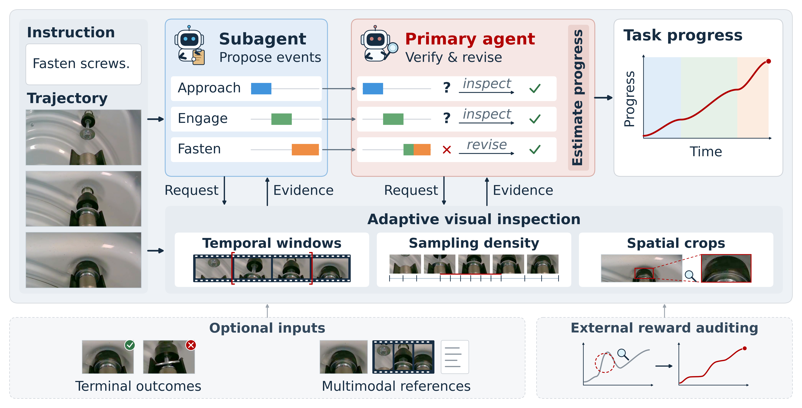

# ARS: Agentic Reward System for Robot Learning

[](https://arxiv.org/abs/2609.34484)



**ARS (Agentic Reward System)** estimates task progress from offline robot
trajectories and task instructions using general-purpose vision-language models,
without additional reward-model training. It combines adaptive visual inspection
with cross-agent verification to track meaningful progress, failed attempts, and
regressions.

This repository contains the ARS implementation and code for constructing the
semantic-mismatch benchmark.

## Installation

Use Python 3.11. From the repository root, run:

```bash
python3.11 -m venv .venv
source .venv/bin/activate
python -m pip install --upgrade pip
python -m pip install -r requirements.txt
```

The default configuration uses **Qwen3.6-27B**. The tested inference setup uses
**vLLM 0.19.1**, **PyTorch 2.10.0**, and **Transformers 5.9.0**,
with the client and server in the same Python environment. Install vLLM in that
environment using the shared dependency requirements:

```bash
python -m pip install -r requirements.txt "vllm==0.19.1"
```

See the [official deployment instructions](https://huggingface.co/Qwen/Qwen3.6-27B#vllm)
for model-serving details.

## Inference

Edit [configs/config.yaml](configs/config.yaml) for agent settings and
[configs/server.yaml](configs/server.yaml) for the model path, GPU IDs, and vLLM
options. Set `--allowed-local-media-path` to the absolute output directory or an
ancestor directory, and keep server ports aligned with the endpoints in
`configs/config.yaml`. The agent and server must share access to these paths.

The default inference configuration was tested on GPUs with 96 GiB of VRAM each.

Optional terminal outcome labels and task references can be configured in
[configs/config.yaml](configs/config.yaml#L30) and
[configs/task_context.yaml](configs/task_context.yaml).

### Batch inference

For batch inference, provide a **LeRobot v2.1 dataset** containing trajectory
images and task instructions. The current reader expects an `image` feature
stored in the episode Parquet files. Pass a single dataset directory containing
`meta/info.json`.

Run the agent with automatic server startup:

```bash
python -m agent.cli run-batch \
  --lerobot-root /path/to/lerobot_dataset \
  --output-root /path/to/outputs \
  --config configs/config.yaml \
  --start-server configs/server.yaml
```

If you prefer to manage vLLM yourself, use the same model and vLLM arguments defined
in `configs/server.yaml`. Set the server endpoints in `configs/config.yaml`, then
run the agent without `--start-server`:

```bash
python -m agent.cli run-batch \
  --lerobot-root /path/to/lerobot_dataset \
  --output-root /path/to/outputs \
  --config configs/config.yaml
```

Results are saved under `<output-root>/<batch-id>/`, where the batch ID is
generated automatically. `batch_results.jsonl` records episode results and
progress artifact paths.

### Optional: Audit external progress proposals

ARS can audit external progress proposals against trajectory images and
task instructions, correcting values unsupported by visual evidence.

For batch inference, provide a `batch_results.jsonl` manifest and its referenced
per-episode progress CSVs, following the same format as ARS outputs. Each selected
LeRobot episode must have exactly one completed result with a full
frame-aligned progress curve normalized to `[0, 1]`.

If your progress estimates come from another repository, please convert
its outputs to this format before passing them to ARS.

Add `--proposal-batch-results /path/to/batch_results.jsonl` to the `run-batch`
command above. Audited results are saved under `<output-root>/<batch-id>/`
in the standard ARS output format.

### Optional: Quick start with a single-video example

Use the bundled single-video examples for a quick trial of ARS.

The [paired examples](examples/inputs/) share the same `video.mp4` but use
matching and mismatched task instructions in their respective `task.txt` files.
Each `progress.csv` contains [Robometer](https://github.com/robometer/robometer)
proposals, linearly interpolated to all frames and expressed as integer
`progress_points` in `[0, 1000]`.

Optionally, omit `progress.csv` to estimate progress directly.

Start vLLM manually as described in [Batch inference](#batch-inference), then run:

```bash
python -m agent.cli run \
  --case-dir examples/inputs/instruction_match \
  --run-dir outputs/examples/instruction_match \
  --config configs/config.yaml
```

Replace `instruction_match` with `instruction_mismatch` in both paths to run the
other case.

The essential output artifacts are included in [examples/outputs](examples/outputs/).

### Optional: Multi-node inference with Ray

ARS can distribute episodes across an existing Ray cluster. Install Ray in the
agent environment using the cluster's version, and make the code, configuration,
model weights, and dataset available at the same absolute paths on every node.
The output directory must be shared across nodes.

Add `--num-nodes` to the managed-server command:

```bash
python -m agent.cli run-batch \
  --lerobot-root /path/to/lerobot_dataset \
  --output-root /path/to/outputs \
  --config configs/config.yaml \
  --start-server configs/server.yaml \
  --num-nodes 2
```

For multiple nodes, `--start-server` is required. Each node launches the server
layout defined in `configs/server.yaml` and processes its assigned episodes.

The batch directory contains `distributed_summary.json` and per-node result
files under `nodes/`. Use all per-node `batch_results.jsonl` files for evaluation.

## Semantic-mismatch benchmark

### Collect trajectories

We use an [adapted version](third_party)
of [RL4VLA](https://github.com/gen-robot/RL4VLA)
to collect trajectories and generate mismatched task instructions.
This requires a **separate simulation environment**.
The ARS inference environment does not include its simulation dependencies.

Initialize the submodule:

```bash
git submodule update --init --recursive
```

Change into `third_party/RL4VLA`, then follow the installation instructions
in its `README.md` to create its environment. Activate that environment before
running the collection command from `third_party/RL4VLA/ManiSkill`:

```bash
python -m mani_skill.examples.motionplanning.widowx.collect_simpler \
  -e "PutOnPlateInScene25MultiCarrot-v1" \
  --save_video --save_data --num_procs 1 --num_traj 500 --seed=100 \
  --obj-set all
```

Trajectory data from this command is saved under
`third_party/RL4VLA/ManiSkill/mp_collect/PutOnPlateInScene25MultiCarrot-v1/500/data`.
The collector includes incorrect task instructions and mismatch types for
constructing the benchmark.

### Convert to LeRobot v2.1

After collection, return to the repository root and switch back to the ARS
environment for LeRobot conversion, agent inference, and progress evaluation.

```bash
python scripts/convert_rl4vla_mp_collect_to_lerobot.py \
  --input-root third_party/RL4VLA/ManiSkill/mp_collect/PutOnPlateInScene25MultiCarrot-v1/500/data \
  --output-dir data/lerobot/semantic_mismatch \
  --add-mismatch-failure
```

For the task above, the converter creates two samples from each successful
trajectory: one with the correct instruction and one with an instruction
referring to the other object in the scene. Both samples share the same images
and actions. The correct-instruction sample is labeled as a success, and the
mismatched-instruction sample is labeled as a failure.

Use the resulting dataset as `--lerobot-root` when running ARS.

### Progress evaluation

Edit [scripts/evaluate_progress_score.yaml](scripts/evaluate_progress_score.yaml)
to specify the dataset and completed `batch_results.jsonl` files. Paths are
relative to the YAML file. Each episode must have exactly one completed result
across the listed files.

```bash
python scripts/evaluate_progress_score.py \
  --config scripts/evaluate_progress_score.yaml \
  --output outputs/progress_scores.json
```

The benchmark reports:

- **VOC:** correlation between estimated progress and time under correct
  instructions.
- **FPSR:** fraction of mismatch duration without positive progress increases.
- **CMPG:** mean terminal progress under correct instructions minus mean peak
  progress under mismatched instructions.

## Citation

If you find our work helpful, please cite the [paper](https://arxiv.org/abs/2609.34484):

```bibtex
@article{Hu2026ARS,
  title   = {{ARS}: Agentic Reward System for Robot Learning},
  author  = {Sheng Hu and Weiyi Lu and Lingbing Zeng and Gan Weng and
             Weiwei Zhang and Kai Xie and Xiaofeng Mou and Yi Xu},
  journal = {arXiv preprint arXiv:2609.34484},
  year    = {2026},
  url     = {https://arxiv.org/abs/2609.34484}
}
```

## License

The ARS agent, scripts, and configuration are licensed under
[Apache-2.0](LICENSE).

Code under [`third_party/RL4VLA`](third_party) retains its respective
upstream licenses. See the accompanying license files for details.
